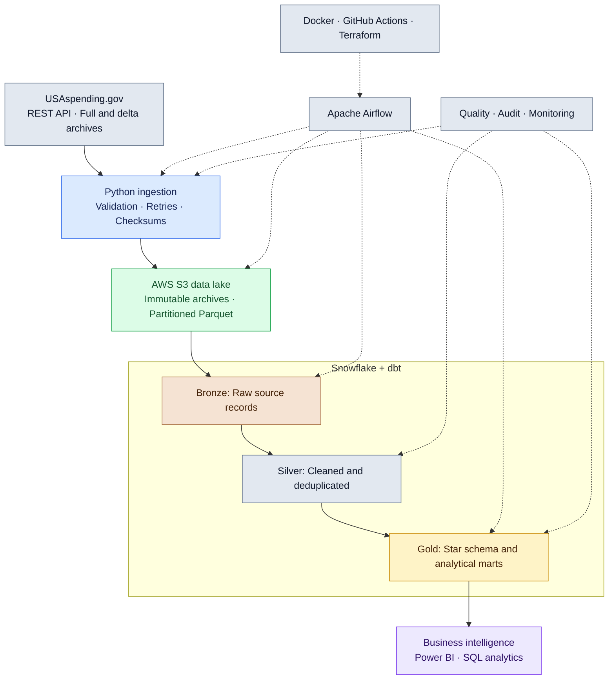
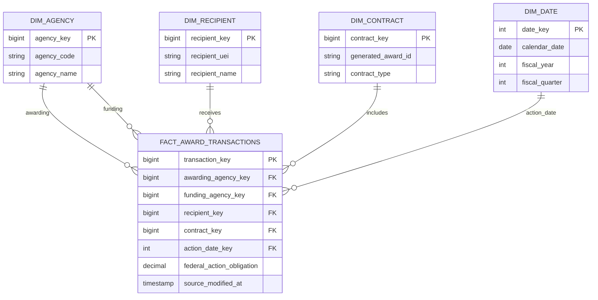
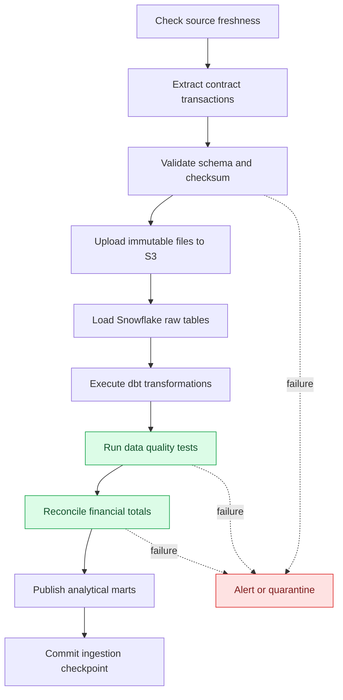

# Federal Spending Intelligence Platform (FSIP)

> Transform raw federal procurement data into reliable, auditable, and actionable spending intelligence.

An enterprise-oriented data engineering portfolio project using USAspending.gov, Python, AWS S3, Snowflake, dbt, and Apache Airflow.

**Status:** Planned architecture / initial development. The diagrams and capabilities below describe the target system, not verified deployed functionality.

## 1. System architecture



The platform separates source extraction, immutable storage, warehouse loading, transformation, validation and analytical publication. DuckDB supports local development before cloud deployment.

## 2. Technology stack

| Technology     | Responsibility       | Skills demonstrated                 |
|----------------|----------------------|-------------------------------------|
| Python         | Data ingestion       | APIs, exception handling, ETL       |
| AWS S3         | Cloud data lake      | Object storage, partitioning        |
| Snowflake      | Data warehouse       | Cloud SQL, RBAC, query optimization |
| dbt Core       | Data transformation  | ELT, modeling, lineage              |
| Apache Airflow | Orchestration        | DAGs, scheduling, backfills         |
| SQL            | Analytics            | Joins, CTEs, window functions       |
| Apache Parquet | Storage format       | Columnar storage, compression       |
| Docker         | Local environment    | Containerization                    |
| Terraform      | Cloud infrastructure | Infrastructure as code              |
| GitHub Actions | CI/CD                | Automated testing and deployment    |
| Pytest         | Testing              | Unit and integration testing        |
| Power BI       | Visualization        | Business intelligence               |
| DuckDB         | Local development    | Low-cost SQL processing             |

Snowflake, dbt and Airflow are the primary specialization.

## 3. Data sources and initial scope

[USAspending.gov](https://www.usaspending.gov/) provides federal procurement, award, recipient, agency and financial transaction data through public APIs and bulk archives.

The target historical scope is FY 2022–2026.

| Organization                    | Reason for inclusion               |
|---------------------------------|------------------------------------|
| Department of Defense           | Defense contracting                |
| Department of Homeland Security | Cybersecurity and infrastructure   |
| Department of Energy            | Scientific research and technology |
| NASA                            | Aerospace and research             |
| General Services Administration | Federal technology procurement     |

Begin with the NASA FY 2026 Contracts Full File. Use October 2025 as a development subset before processing the complete year and expanding to other agencies. Fiscal years begin October 1 of the preceding calendar year.

### API endpoints

| Candidate endpoint                             | Intended purpose                |
|------------------------------------------------|---------------------------------|
| `/api/v2/bulk_download/awards/`                | Historical extraction           |
| `/api/v2/bulk_download/status/`                | Download job monitoring         |
| `/api/v2/awards/last_updated/`                 | Source freshness                |
| `/api/v2/references/toptier_agencies/`         | Agency reference data           |
| `/api/v2/references/naics/`                    | Industry classification         |
| `/api/v2/search/transaction_spending_summary/` | Financial reconciliation        |
| `/api/v2/transactions/`                        | Award transaction investigation |

Validate endpoint paths, methods, request schemas and date filters against the official API contract before implementation.

### Full and delta archives

Full files establish historical baselines. Delta files carry additions, corrections and deletions across their published coverage period. The archive's `correction_delete_ind` field identifies additions (blank), corrections (`C`) and deletions (`D`). Archive coverage and baseline dates must be aligned before applying deltas.

### Official resources

- [API documentation](https://api.usaspending.gov/docs/endpoints)
- [USAspending API source code](https://github.com/fedspendingtransparency/usaspending-api)
- [Federal Spending Guide](https://www.usaspending.gov/federal-spending-guide)
- [Award Data Archive](https://www.usaspending.gov/download_center/award_data_archive)

## 4. Enterprise data warehouse model

The proposed dimensional star schema separates analytical facts from operational audit records. Agency is a role-playing dimension for awarding and funding agencies.



The diagram shows the core logical model. Physical types, source identifiers and historical dimension joins must be validated during implementation.

### Dimension tables

| Table           | Modeling technique                   |
|-----------------|--------------------------------------|
| `DIM_AGENCY`    | Slowly changing dimension Type 2     |
| `DIM_RECIPIENT` | Slowly changing dimension Type 2     |
| `DIM_CONTRACT`  | Slowly changing dimension Type 2     |
| `DIM_DATE`      | Static calendar and fiscal dimension |
| `DIM_NAICS`     | Industry classification              |
| `DIM_GEOGRAPHY` | Location dimension                   |

### Fact and operational tables

| Table                      | Grain                                                |
|----------------------------|------------------------------------------------------|
| `FACT_AWARD_TRANSACTIONS`  | One current record per source transaction            |
| `FACT_TRANSACTION_HISTORY` | One record per observed transaction version          |
| `FACT_PIPELINE_AUDIT`      | One record per pipeline execution                    |
| `FACT_DATA_QUALITY`        | One record per validation check and execution        |
| `FACT_RECONCILIATION`      | One record per source-to-target reconciliation scope |

### Analytical data marts

| Data mart                     | Business question                                  |
|-------------------------------|----------------------------------------------------|
| `MART_AGENCY_SPENDING`        | Which agencies obligate the most funding?          |
| `MART_CONTRACTOR_ANALYSIS`    | Which contractors receive the largest obligations? |
| `MART_FISCAL_TRENDS`          | How does procurement change across fiscal years?   |
| `MART_SPENDING_GEOGRAPHY`     | Where are federal contracts performed?             |
| `MART_INDUSTRY_SPENDING`      | Which industries receive federal funding?          |
| `MART_CONTRACT_MODIFICATIONS` | How frequently are contracts modified?             |
| `MART_DATA_QUALITY`           | Can analysts trust the underlying data?            |

## 5. Production data engineering requirements

| Capability                          | Design requirement                                                                             |
|-------------------------------------|------------------------------------------------------------------------------------------------|
| Incremental ingestion and backfills | Last-modified-date watermarks, overlapping windows, durable checkpoints and replayable jobs    |
| Idempotency and deduplication       | Reprocessing identical input must not duplicate transactions or inflate totals                 |
| Historical preservation             | Preserve previous record versions, hashes, ingestion timestamps and source modification dates  |
| Financial reconciliation            | Compare transaction counts and net obligations across equivalent source and target scopes      |
| Data governance                     | Snowflake RBAC, least privilege, documented lineage and classification                         |
| Observability and failure recovery  | Monitor failures, rejected records, latency, freshness, schema drift and warehouse consumption |

**Financial correctness:** Obligations are not actual outlays. Preserve negative obligations and use decimal-safe financial types. Preserve original source files and audit corrections and deletions.

## 6. Apache Airflow pipeline



| DAG                            | Schedule  |
|--------------------------------|-----------|
| `federal_spending_incremental` | Daily     |
| `federal_spending_backfill`    | On demand |
| `reference_data_refresh`       | Weekly    |
| `historical_reconciliation`    | Weekly    |
| `warehouse_maintenance`        | Monthly   |

Checkpoints advance only after successful validation and publication. A daily task checks for source updates; it does not assume new monthly archive files are available every day.

## 7. Planned repository structure

```text
federal-spending-data-warehouse/
├── .github/
│   └── workflows/
│       ├── ci.yml
│       └── dbt-ci.yml
├── airflow/
│   └── dags/
│       ├── incremental.py
│       ├── backfill.py
│       ├── reference_data.py
│       ├── reconciliation.py
│       └── maintenance.py
├── ingestion/
│   ├── clients/
│   │   └── usaspending.py
│   ├── extractors/
│   ├── validators/
│   ├── storage/
│   │   ├── local.py
│   │   └── s3.py
│   ├── checkpoints.py
│   └── pipeline.py
├── warehouse/
│   ├── ddl/
│   ├── security/
│   └── snowflake/
├── transformations/
│   ├── dbt_project.yml
│   ├── models/
│   │   ├── staging/
│   │   ├── intermediate/
│   │   └── marts/
│   │       ├── dimensions/
│   │       └── facts/
│   ├── snapshots/
│   ├── macros/
│   ├── seeds/
│   └── tests/
├── infrastructure/
│   └── terraform/
├── analytics/
│   ├── sql/
│   ├── dashboards/
│   └── notebooks/
├── tests/
│   ├── unit/
│   ├── integration/
│   └── fixtures/
├── docs/
│   ├── architecture.md
│   ├── data_dictionary.md
│   ├── data_lineage.md
│   ├── runbook.md
│   └── adr/
├── scripts/
├── docker-compose.yml
├── Dockerfile
├── Makefile
├── pyproject.toml
├── .env.example
├── .gitignore
├── LICENSE
└── README.md
```

## 8. Implementation roadmap

- [ ] Local ingestion, archive validation, manifests and Parquet conversion
- [ ] DuckDB profiling and financial reconciliation
- [ ] S3 storage and Snowflake raw ingestion
- [ ] dbt staging, dimensions, facts and analytical marts
- [ ] Airflow orchestration, checkpoints, backfills and delta processing
- [ ] Governance, monitoring, automated testing and CI/CD
- [ ] Terraform infrastructure and analytical dashboards
- [ ] Document measured performance and publish reproducible examples

## 9. Getting started

For initial local development, download the NASA FY 2026 Contracts Full File from the Award Data Archive and retain the original ZIP.

```bash
python3.12 -m venv .venv
source .venv/bin/activate
python -m pip install --upgrade pip
mkdir -p data/raw/usaspending/contracts/full/nasa/fy2026
```

Place the ZIP in that directory. Do not commit downloaded archives, credentials or generated datasets. Installation and pipeline execution commands will be added when the corresponding code is implemented.

## 10. Acceptance criteria

- No duplicate current transaction keys.
- Exact financial reconciliation for equivalent complete scopes.
- Repeatable ingestion and recovery without duplicated transactions.
- Historical corrections and deletions are auditable.
- Published marts have documented lineage and quality tests.
- No hardcoded credentials.

## 11. Data attribution

Source: USAspending.gov. This is an independent portfolio project and is not an official government service. No production deployment or performance results are claimed at this stage.

