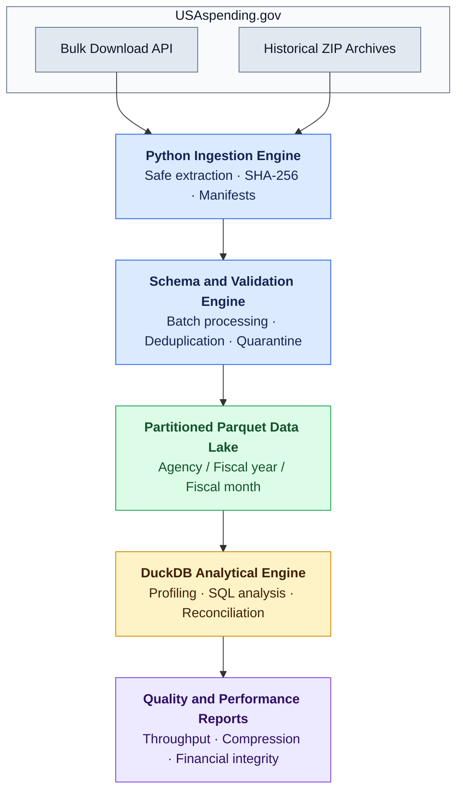
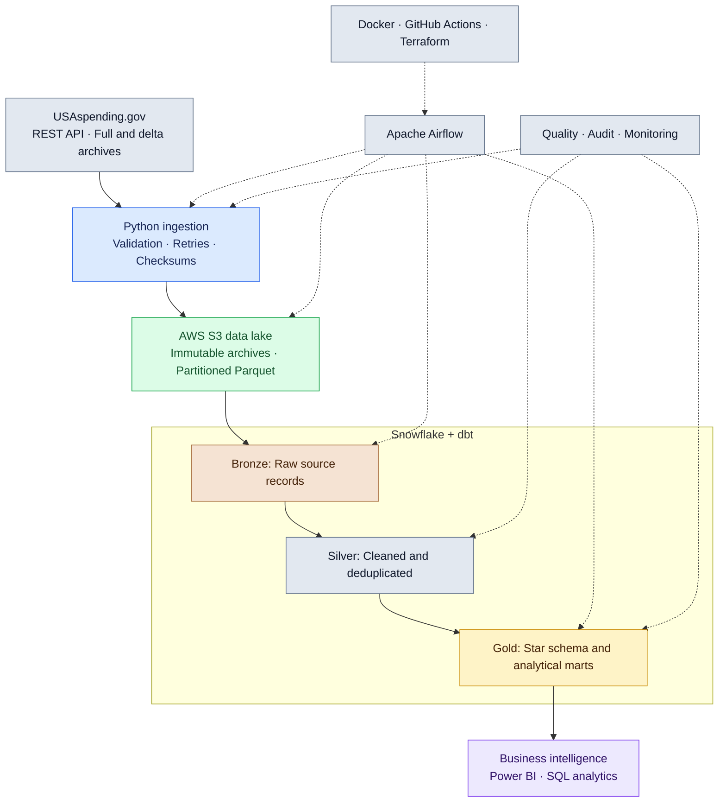
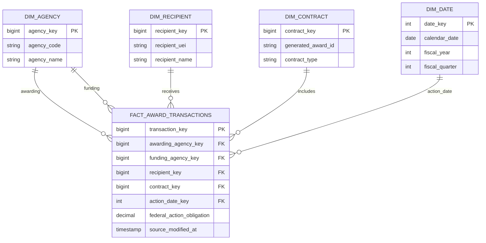
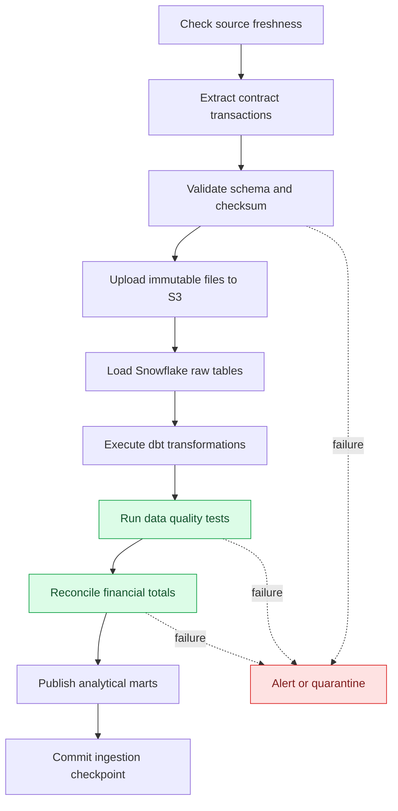

# Federal Spending Data Warehouse

> Transform raw federal procurement data into reliable, auditable, and actionable spending intelligence.

The Federal Spending Intelligence Platform (FSIP) is an enterprise-oriented data engineering project built on [USAspending.gov](https://www.usaspending.gov/).

**Status: Phase 1, Milestone 1 complete (reported).** Local API ingestion, validation, immutable archival, Parquet conversion, provenance and DuckDB reconciliation are implemented. AWS S3, Snowflake, dbt and Airflow remain planned; the cloud architecture diagrams describe the target system.

## Current implementation

```text
USAspending bulk_download API
        │  (async job: submit → poll → stream ZIP)
        ▼
 data/raw/<slug>/…             immutable source ZIP + extracted CSV
        │  (SHA-256 checksum, safe extraction)
        ▼
 validation + quarantine       schema contract, typing, dedup, negative-safe
        │
        ├──► data/parquet/<slug>.parquet     typed, decimal-exact valid rows
        ├──► data/quarantine/<slug>.csv      rejected rows + reasons
        └──► data/manifests/<slug>.json      provenance + reconciliation
```

- **Raw is immutable:** downloaded ZIPs are checksummed using SHA-256; normalization happens in derived Parquet.
- **Decimal-safe money:** financial fields use `decimal128(23,2)`; negative obligations are preserved.
- **No silent row rejection:** invalid rows are quarantined with machine-readable reasons.
- **Idempotent extraction:** deterministic output paths and completed-work skipping; `--force` reprocesses.
- **Schema drift is loud:** missing required columns abort ingestion; the observed 297-column layout is fingerprinted in the manifest.

### Milestone 1 validation

| Metric | Reported result |
|---|---|
| NASA October 2025 transactions | 196 |
| Valid / quarantined | 196 / 0 |
| Negative obligations preserved | 6 |
| Ingestion test coverage | 92% |
| Live API test | 1 passed |
| DuckDB reconciliation | Passed |
| Ruff lint and format | Passed |

These results describe the reported local execution, not remote CI or cloud deployment verification.

## Milestone 2 — Historical Ingestion Architecture

Milestone 2 extends the API ingestion pipeline into a scalable historical platform:
full-archive ingestion, bounded-memory batch processing, federal fiscal-year/month
partitioning, a versioned schema registry, historical profiling, exact financial
reconciliation as a publication gate, and performance benchmarking — all local, no
paid cloud infrastructure.



Both historical ZIP archives and API-generated archives enter the same Python
ingestion engine. Original source files remain immutable (checksummed, never
modified). Validation failures are explicitly quarantined or rejected — never
silently dropped. Candidate Parquet partitions are first written to a **staging**
area; DuckDB performs profiling and decimal-exact financial reconciliation against
the candidate dataset *before* publication. Only successfully reconciled datasets
are atomically published into the analytical paths, and conflicting re-ingests of
already-published data are detected and refused rather than overwritten. The reports
provide evidence of data quality, financial integrity, and measured processing
performance. This diagram shows the logical data flow; the detailed staging,
reconciliation, quarantine, and atomic-publication lifecycle is documented in
[`docs/ARCHITECTURE.md`](docs/ARCHITECTURE.md) and [`docs/PARTITIONING.md`](docs/PARTITIONING.md).

### Milestone 2 status — implementation complete; real-data acceptance passed for NASA

Implemented and verified against **two real NASA Contracts Full File archives**
(FY2025 and FY2026) pulled from the USAspending bulk-download API:

| Capability | Status |
|---|---|
| Full-archive ZIP ingestion (multi-member, streaming, bounded memory) | Implemented |
| Archive safety (integrity, path-traversal, symlink, file-type, size/count caps) | Implemented |
| Extensible agency registry (NASA, DoD, DHS, DOE, GSA; authoritative codes) | Implemented |
| Federal fiscal-year / fiscal-month Hive partitioning | Implemented |
| Cross-batch / cross-member deduplication + quarantine | Implemented |
| Versioned schema registry + historical comparison | Implemented |
| Staging → reconcile (gate) → atomic publish, with conflict detection | Implemented |
| Idempotent + resumable reprocessing | Implemented |
| Historical profiling (JSON + Markdown) | Implemented |
| DuckDB historical analytics (12 queries) | Implemented |
| Performance benchmarking | Implemented |
| Multi-agency / FY2022–2024 real-data backfill | **Pending** (code ready; archives not downloaded — see Limitations) |

### Verified Milestone 2 results (real NASA data)

| Metric | FY2025 | FY2026 |
|---|---|---|
| Source transactions | 21,284 | 17,603 |
| Valid / quarantined / filtered | 21,284 / 0 / 0 | 17,603 / 0 / 0 |
| Distinct awards / recipients | 9,502 / 3,021 | 8,309 / 2,701 |
| Fiscal-month partitions | 12 | 12 |
| **Net obligation** | **$15,787,739,509.64** | **$16,095,847,228.00** |
| Positive / negative obligation | $16,337,439,738.27 / −$549,700,228.63 | $16,634,474,156.87 / −$538,626,928.87 |
| De-obligations (negative count) | 1,716 | 1,281 |
| Source→Parquet compression | 7.92× | 7.46× |
| Reconciliation (source→target, per-partition) | PASSED | PASSED |
| Schema fingerprint | `36933b68…f85a03` | `36933b68…f85a03` (identical) |

Combined, the two published fiscal years hold **38,887 transactions** reconciling to
a net **$31.88B** in obligations, with **zero duplicate transaction keys**. A
cross-fiscal-year schema comparison (FY2025 → FY2026) classifies as **compatible /
identical** (297 columns, unchanged). See [`docs/DATA_PROFILING.md`](docs/DATA_PROFILING.md)
and [`docs/SCHEMA_EVOLUTION.md`](docs/SCHEMA_EVOLUTION.md).

### Measured performance (NASA FY2026; macOS arm64, Python 3.12, DuckDB 1.5.6, PyArrow 18.1.0)

| Metric | Value |
|---|---|
| End-to-end ingestion (min of repeats) | 1.12 s |
| Throughput | ~15,800 transactions/sec |
| Peak process memory (subprocess RSS) | ~452 MB |
| Partition pruning (single fiscal month) | scans 1 of 12 files, 1,450 of 17,603 rows (91.8% skipped) |

At this dataset size a single-month *wall-time* speedup from partitioning is modest
or negative (per-file open overhead dominates), which is reported honestly in
[`docs/PERFORMANCE.md`](docs/PERFORMANCE.md); pruning still provably reduces data
scanned and the benefit grows with scale.

### Milestone 2 commands

```bash
# Ingest a full contract archive ZIP into the partitioned lake
fsdw ingest-archive --path <archive.zip> --agency NASA --fiscal-year 2026

# Backfill a fiscal-year range from local archives (add --download to fetch missing)
fsdw backfill --agency NASA --start-fy 2025 --end-fy 2026

# Inventory local datasets, profile, reconcile, benchmark, compare schemas
fsdw list-datasets
fsdw profile          --agency NASA --fiscal-year 2026
fsdw reconcile        --agency NASA --fiscal-year 2026
fsdw benchmark        --agency NASA --fiscal-year 2026
fsdw compare-schemas  --agency NASA --from-fy 2025 --to-fy 2026

# Run the DuckDB historical analytics suite (12 queries)
python analytics/run_analytics.py
```

Common options where applicable: `--data-dir`, `--batch-size`, `--compression`,
`--row-group-size`, `--dry-run`, `--force`, `--resume`. See
[`docs/RUNBOOK.md`](docs/RUNBOOK.md) for full operational guidance.

## Milestone 2.1 — Acceptance and Hardening

Milestone 2.1 closed the outstanding acceptance gaps: real **manually-downloaded
Award Data Archive** files, multi-year and multi-agency coverage at **>1M
transactions**, dataset-wide integrity validation, and **external** reconciliation
against USAspending's own aggregate endpoint.

### Published data lake (all contracts-only scope: award types A/B/C/D)

| Agency | FY | Source rows | Published | Filtered (IDVs/scope) | De-obligations | Net obligation |
|---|---|---|---|---|---|---|
| NASA | 2022 | 27,045 | 23,015 | 4,030 | 1,661 | $15,239,515,074.07 |
| NASA | 2023 | 24,868 | 20,918 | 3,950 | 1,602 | $16,129,077,722.63 |
| NASA | 2024 | 23,182 | 19,779 | 3,403 | 1,653 | $15,015,940,724.18 |
| NASA | 2025 | 21,284 | 21,284 | 0 | 1,716 | $15,787,739,509.64 |
| NASA | 2026 | 17,603 | 17,603 | 0 | 1,281 | $16,095,847,228.00 |
| DOE | 2026 | 11,376 | 10,469 | 907 | 1,084 | $55,135,256,088.16 |
| GSA | 2026 | 1,437,500 | 1,300,826 | 136,674 | 43,168 | $28,724,193,258.25 |
| **Total** | | **1,562,858** | **1,413,894** | | | **$162,127,569,604.93** |

Every dataset: **0 quarantined**, reconciliation (source→target + per-partition) **PASSED**,
12 fiscal-month partitions, negatives preserved. NASA FY2022–2024 came from the
**manual** Award Data Archive (IDVs filtered to match the contracts-only lake);
FY2025–2026 are the retained Milestone-2 API datasets (unchanged). GSA FY2026
(**1.44M source rows, 2 CSV members, 3.2 GB uncompressed**) is the scale test.

### Dataset-wide integrity

`fsdw audit-integrity` over the whole lake: **1,413,894 published rows,
1,413,894 distinct transaction keys, 0 duplicates, 0 cross-dataset collisions →
PASSED**. Publication is now blocked if a candidate dataset's transaction keys
collide with another published dataset (prevents double-counting); conflicts are
reported, never silently overwritten. See [`docs/SCHEMA_EVOLUTION.md`](docs/SCHEMA_EVOLUTION.md).

### External financial reconciliation (vs USAspending `spending_over_time`)

Equivalent scope (awarding agency, fiscal year by `action_date`, award types A/B/C/D):

| Dataset | Local net | External aggregate | Difference |
|---|---|---|---|
| NASA FY2024 | $15,015,940,724.18 | $15,015,940,724.18 | **$0.00 (exact)** |
| NASA FY2025 | $15,787,739,509.64 | $15,787,739,509.64 | **$0.00 (exact)** |
| NASA FY2026 | $16,095,847,228.00 | $16,095,925,883.00 | −$78,655 (0.0005%) |
| DOE FY2026 | $55,135,256,088.16 | $55,135,498,845.76 | −$242,758 (0.0004%) |
| GSA FY2026 | $28,724,193,258.25 | $28,936,083,564.31 | −$211.9M (0.73%) |

Settled fiscal years reconcile **exactly to the cent**; the most-recent/high-churn
datasets differ only by data-refresh timing (live aggregate vs point-in-time
snapshot), all within a 1% tolerance. Run with `fsdw reconcile-external`.

### Manual vs API archive comparison (NASA FY2026)

The manual Award Data Archive and the API bulk-download share an **identical
297-column schema** (no normalization needed). The manual "Contracts Full" file
carries **23,540 rows** (contracts + IDVs); filtered to contracts-only it is 17,592
rows / $16.093B, matching the API dataset (17,603 / $16.096B) to within the
data-refresh delta. The difference is award-type **scope** (IDVs), not schema.

### New Milestone 2.1 commands

```bash
# Dataset-wide integrity audit (cross-dataset duplicate transactions)
fsdw audit-integrity

# External reconciliation vs the USAspending aggregate endpoint (network)
fsdw reconcile-external --agency NASA --fiscal-year 2026

# Backfill from the canonical manual Award Data Archive, contracts-only scope
fsdw backfill --agency NASA --start-fy 2022 --end-fy 2024 --download --award-types contracts
```

### Scale & performance

The lake holds **1.41M published transactions**, exceeding the 1M scale target.
GSA FY2026 (1.3M published rows from a 3.2 GB uncompressed, 2-member archive)
ingested end-to-end in ~113 s (~11,500 transactions/sec) under bounded-memory
streaming. Measured benchmarks (throughput, peak memory, and partition-pruning
effectiveness at scale) are in [`docs/PERFORMANCE.md`](docs/PERFORMANCE.md).

## Requirements and quickstart

Python **3.12+**. The public API requires no credentials; this milestone provisions no paid cloud infrastructure. Run from the cloned repository root.

```bash
python3.12 -m venv .venv
source .venv/bin/activate
pip install -e ".[dev]"
# Optional environment template
cp .env.example .env
fsdw extract --agency NASA --start 2025-10-01 --end 2025-10-31
python analytics/reconcile.py \
  --parquet data/parquet/nasa_contracts_action_date_20251001_20251031.parquet \
  --manifest data/manifests/nasa_contracts_action_date_20251001_20251031.json
```

One-shot wrapper: `scripts/run_nasa_october_2025.sh`.

### CLI reference

```bash
# Optional arguments are shown in brackets; omit brackets when executing.
fsdw extract --agency NASA --start 2025-10-01 --end 2025-10-31 \
  [--award-types contracts|idvs|contracts_and_idvs] \
  [--date-type action_date|last_modified_date] \
  [--agency-type awarding|funding] \
  [--data-dir ./data] \
  [--force]
fsdw agencies
```

Module alternative:

```bash
python -m ingestion.cli extract --agency NASA --start 2025-10-01 --end 2025-10-31
```

### Testing

```bash
pytest
pytest --cov=ingestion --cov-report=term-missing
ruff check .
ruff format --check .
pytest -m live  # opt-in, requires network and downloads real data
```

GitHub Actions (`.github/workflows/ci.yml`) is configured to run Ruff and offline tests on pushes and pull requests to main.

### Output layout

| Path | Contents |
|---|---|
| `data/raw/<slug>/*.zip` | Immutable checksummed ZIP |
| `data/raw/<slug>/extracted/*.csv` | Safely extracted CSV |
| `data/parquet/<slug>.parquet` | Typed valid transactions |
| `data/quarantine/<slug>.csv` | Rejected rows and `_quarantine_reasons` |
| `data/manifests/<slug>.json` | Provenance and reconciliation |

The slug is deterministic, e.g. `nasa_contracts_action_date_20251001_20251031`. The `data/` directory is git-ignored. Never commit credentials or generated datasets.

## Target system architecture



The platform separates source extraction, immutable storage, warehouse loading, transformation, validation and analytical publication. DuckDB supports local development before cloud deployment.

## Technology stack

| Technology     | Responsibility       | Skills demonstrated                 |
|----------------|----------------------|-------------------------------------|
| Python         | Data ingestion       | APIs, exception handling, ETL       |
| AWS S3         | Cloud data lake      | Object storage, partitioning        |
| Snowflake      | Data warehouse       | Cloud SQL, RBAC, query optimization |
| dbt Core       | Data transformation  | ELT, modeling, lineage              |
| Apache Airflow | Orchestration        | DAGs, scheduling, backfills         |
| SQL            | Analytics            | Joins, CTEs, window functions       |
| Apache Parquet | Storage format       | Columnar storage, compression       |
| Docker         | Local environment    | Containerization                    |
| Terraform      | Cloud infrastructure | Infrastructure as code              |
| GitHub Actions | CI/CD                | Automated testing and deployment    |
| Pytest         | Testing              | Unit and integration testing        |
| Power BI       | Visualization        | Business intelligence               |
| DuckDB         | Local development    | Low-cost SQL processing             |

Snowflake, dbt and Airflow are the primary specialization.

## Data sources and historical scope

[USAspending.gov](https://www.usaspending.gov/) provides federal procurement, award, recipient, agency and financial transaction data through public APIs and bulk archives.

The target historical scope is FY 2022–2026.

| Organization                    | Reason for inclusion               |
|---------------------------------|------------------------------------|
| Department of Defense           | Defense contracting                |
| Department of Homeland Security | Cybersecurity and infrastructure   |
| Department of Energy            | Scientific research and technology |
| NASA                            | Aerospace and research             |
| General Services Administration | Federal technology procurement     |

The October 2025 NASA API extraction is the initial development dataset. Processing the NASA FY 2026 Contracts Full File and expanding to other agencies are planned next steps. Fiscal years begin October 1 of the preceding calendar year.

### API endpoints

| Candidate endpoint                             | Intended purpose                |
|------------------------------------------------|---------------------------------|
| `/api/v2/bulk_download/awards/`                | Historical extraction           |
| `/api/v2/bulk_download/status/`                | Download job monitoring         |
| `/api/v2/awards/last_updated/`                 | Source freshness                |
| `/api/v2/references/toptier_agencies/`         | Agency reference data           |
| `/api/v2/references/naics/`                    | Industry classification         |
| `/api/v2/search/transaction_spending_summary/` | Financial reconciliation        |
| `/api/v2/transactions/`                        | Award transaction investigation |

Validate endpoint paths, methods, request schemas and date filters against the official API contract before implementation.

### Full and delta archives

Full files establish historical baselines. Delta files carry additions, corrections and deletions across their published coverage period. The archive's `correction_delete_ind` field identifies additions (blank), corrections (`C`) and deletions (`D`). Archive coverage and baseline dates must be aligned before applying deltas.

### Official resources

- [API documentation](https://api.usaspending.gov/docs/endpoints)

- [USAspending API source code](https://github.com/fedspendingtransparency/usaspending-api)

- [Federal Spending Guide](https://www.usaspending.gov/federal-spending-guide)

- [Award Data Archive](https://www.usaspending.gov/download_center/award_data_archive)

## Planned enterprise data warehouse model

The proposed dimensional star schema separates analytical facts from operational audit records. Agency is a role-playing dimension for awarding and funding agencies.



The diagram shows the core logical model. Physical types, source identifiers and historical dimension joins must be validated during implementation.

### Dimension tables

| Table           | Modeling technique                   |
|-----------------|--------------------------------------|
| `DIM_AGENCY`    | Slowly changing dimension Type 2     |
| `DIM_RECIPIENT` | Slowly changing dimension Type 2     |
| `DIM_CONTRACT`  | Slowly changing dimension Type 2     |
| `DIM_DATE`      | Static calendar and fiscal dimension |
| `DIM_NAICS`     | Industry classification              |
| `DIM_GEOGRAPHY` | Location dimension                   |

### Fact and operational tables

| Table                      | Grain                                                |
|----------------------------|------------------------------------------------------|
| `FACT_AWARD_TRANSACTIONS`  | One current record per source transaction            |
| `FACT_TRANSACTION_HISTORY` | One record per observed transaction version          |
| `FACT_PIPELINE_AUDIT`      | One record per pipeline execution                    |
| `FACT_DATA_QUALITY`        | One record per validation check and execution        |
| `FACT_RECONCILIATION`      | One record per source-to-target reconciliation scope |

### Analytical data marts

| Data mart                     | Business question                                  |
|-------------------------------|----------------------------------------------------|
| `MART_AGENCY_SPENDING`        | Which agencies obligate the most funding?          |
| `MART_CONTRACTOR_ANALYSIS`    | Which contractors receive the largest obligations? |
| `MART_FISCAL_TRENDS`          | How does procurement change across fiscal years?   |
| `MART_SPENDING_GEOGRAPHY`     | Where are federal contracts performed?             |
| `MART_INDUSTRY_SPENDING`      | Which industries receive federal funding?          |
| `MART_CONTRACT_MODIFICATIONS` | How frequently are contracts modified?             |
| `MART_DATA_QUALITY`           | Can analysts trust the underlying data?            |

## Production data engineering requirements

| Capability                          | Design requirement                                                                             |
|-------------------------------------|------------------------------------------------------------------------------------------------|
| Incremental ingestion and backfills | Last-modified-date watermarks, overlapping windows, durable checkpoints and replayable jobs    |
| Idempotency and deduplication       | Reprocessing identical input must not duplicate transactions or inflate totals                 |
| Historical preservation             | Preserve previous record versions, hashes, ingestion timestamps and source modification dates  |
| Financial reconciliation            | Compare transaction counts and net obligations across equivalent source and target scopes      |
| Data governance                     | Snowflake RBAC, least privilege, documented lineage and classification                         |
| Observability and failure recovery  | Monitor failures, rejected records, latency, freshness, schema drift and warehouse consumption |

**Financial correctness:** Obligations are not actual outlays. Preserve negative obligations and use decimal-safe financial types. Preserve original source files and audit corrections and deletions.

## Planned Apache Airflow pipeline



| DAG                            | Schedule  |
|--------------------------------|-----------|
| `federal_spending_incremental` | Daily     |
| `federal_spending_backfill`    | On demand |
| `reference_data_refresh`       | Weekly    |
| `historical_reconciliation`    | Weekly    |
| `warehouse_maintenance`        | Monthly   |

Checkpoints advance only after successful validation and publication. A daily task checks for source updates; it does not assume new monthly archive files are available every day.

## Current repository structure

```text
Federal-Spending-Data/
├── .github/workflows/ci.yml
├── ingestion/
│   ├── config.py            # env-driven settings + data-lake layout
│   ├── client.py            # HTTP transport, retries, safe download/extract
│   ├── models.py            # data contract + fiscal-calendar helpers
│   ├── agencies.py          # extensible agency registry (M2)
│   ├── validate.py          # schema/type/dedup validation + quarantine
│   ├── storage.py           # decimal-safe Parquet via PyArrow
│   ├── partitioning.py      # fiscal Hive partitioning + streaming writer (M2)
│   ├── archive.py           # full-archive ingestion pipeline (M2)
│   ├── schema_registry.py   # versioned schema registry + comparison (M2)
│   ├── reconciliation.py    # decimal-exact reconciliation / publish gate (M2)
│   ├── profiling.py         # historical profiling → JSON + Markdown (M2)
│   ├── benchmarking.py      # performance benchmarking (M2)
│   ├── discovery.py         # local dataset discovery / inventory (M2)
│   ├── checkpoints.py       # resumable-ingestion checkpoints (M2)
│   ├── manifest.py          # provenance manifests
│   ├── extract.py           # M1 API extraction orchestration
│   └── cli.py               # fsdw CLI (M1 + M2 commands)
├── analytics/
│   ├── reconcile.py / reconcile.sql   # M1 reconciliation
│   ├── sql/                 # 12 historical analytics queries (M2)
│   ├── run_analytics.py     # runs the SQL suite → reports (M2)
│   └── reports/             # generated analytics reports (git-ignored output)
├── tests/                   # unit + integration tests (live tests opt-in)
├── scripts/                 # reproducibility + README graphics check
├── airflow/dags/            # Stub (Milestone 6)
├── warehouse/               # Stub (Milestone 4)
├── transformations/         # Stub (Milestone 5)
├── infrastructure/terraform/ # Stub (Milestone 3, no paid infra)
├── docs/                    # architecture, data dictionary, partitioning,
│                            #   schema evolution, profiling, performance, runbook
├── data/                    # all raw/staged/published/profiles/benchmarks (git-ignored)
├── pyproject.toml
├── .env.example
├── .gitignore
├── LICENSE
└── README.md
```

## Implementation roadmap

- [x] Milestone 1: API ingestion, validation, manifests, Parquet and local reconciliation
- [x] Milestone 2: Full archive ingestion, historical profiling and partitioning
- [x] Milestone 2.1: Acceptance & hardening — manual archives, NASA FY2022–2026, DOE & GSA FY2026 (1.41M transactions), dataset-wide integrity, external reconciliation
- [ ] Milestone 3: AWS S3 data lake
- [ ] Milestone 4: Snowflake warehouse
- [ ] Milestone 5: dbt dimensional models and marts
- [ ] Milestone 6: Airflow orchestration and backfills
- [ ] Milestone 7: CDC, governance and production monitoring
- [ ] Milestone 8: Business intelligence, deployment and performance documentation

## Documentation

- [Architecture](docs/ARCHITECTURE.md) — components, data flow, design decisions and roadmap.
- [Data dictionary](docs/DATA_DICTIONARY.md) — stable contract columns, types and semantics.
- [Partitioning](docs/PARTITIONING.md) — fiscal calendar, Hive layout, atomic publication.
- [Schema evolution](docs/SCHEMA_EVOLUTION.md) — registry, comparison and compatibility policy.
- [Data profiling](docs/DATA_PROFILING.md) — profiling methodology and reproducible findings.
- [Performance](docs/PERFORMANCE.md) — measured benchmarks and partition-pruning evidence.
- [Runbook](docs/RUNBOOK.md) — operational commands and recovery procedures.

## Target repository structure

```text
federal-spending-data-warehouse/
├── .github/
│   └── workflows/
│       ├── ci.yml
│       └── dbt-ci.yml
├── airflow/
│   └── dags/
│       ├── incremental.py
│       ├── backfill.py
│       ├── reference_data.py
│       ├── reconciliation.py
│       └── maintenance.py
├── ingestion/
│   ├── clients/
│   │   └── usaspending.py
│   ├── extractors/
│   ├── validators/
│   ├── storage/
│   │   ├── local.py
│   │   └── s3.py
│   ├── checkpoints.py
│   └── pipeline.py
├── warehouse/
│   ├── ddl/
│   ├── security/
│   └── snowflake/
├── transformations/
│   ├── dbt_project.yml
│   ├── models/
│   │   ├── staging/
│   │   ├── intermediate/
│   │   └── marts/
│   │       ├── dimensions/
│   │       └── facts/
│   ├── snapshots/
│   ├── macros/
│   ├── seeds/
│   └── tests/
├── infrastructure/
│   └── terraform/
├── analytics/
│   ├── sql/
│   ├── dashboards/
│   └── notebooks/
├── tests/
│   ├── unit/
│   ├── integration/
│   └── fixtures/
├── docs/
│   ├── architecture.md
│   ├── data_dictionary.md
│   ├── data_lineage.md
│   ├── runbook.md
│   └── adr/
├── scripts/
├── docker-compose.yml
├── Dockerfile
├── Makefile
├── pyproject.toml
├── .env.example
├── .gitignore
├── LICENSE
└── README.md
```

## Target acceptance criteria

- No duplicate current transaction keys.

- Exact financial reconciliation for equivalent complete scopes.

- Repeatable ingestion and recovery without duplicated transactions.

- Historical corrections and deletions are auditable.

- Published marts have documented lineage and quality tests.

- No hardcoded credentials.

## Data attribution

Source: USAspending.gov. This is an independent portfolio project and is not an official government service. No cloud production deployment is claimed at this stage.


## License

[MIT](LICENSE).
