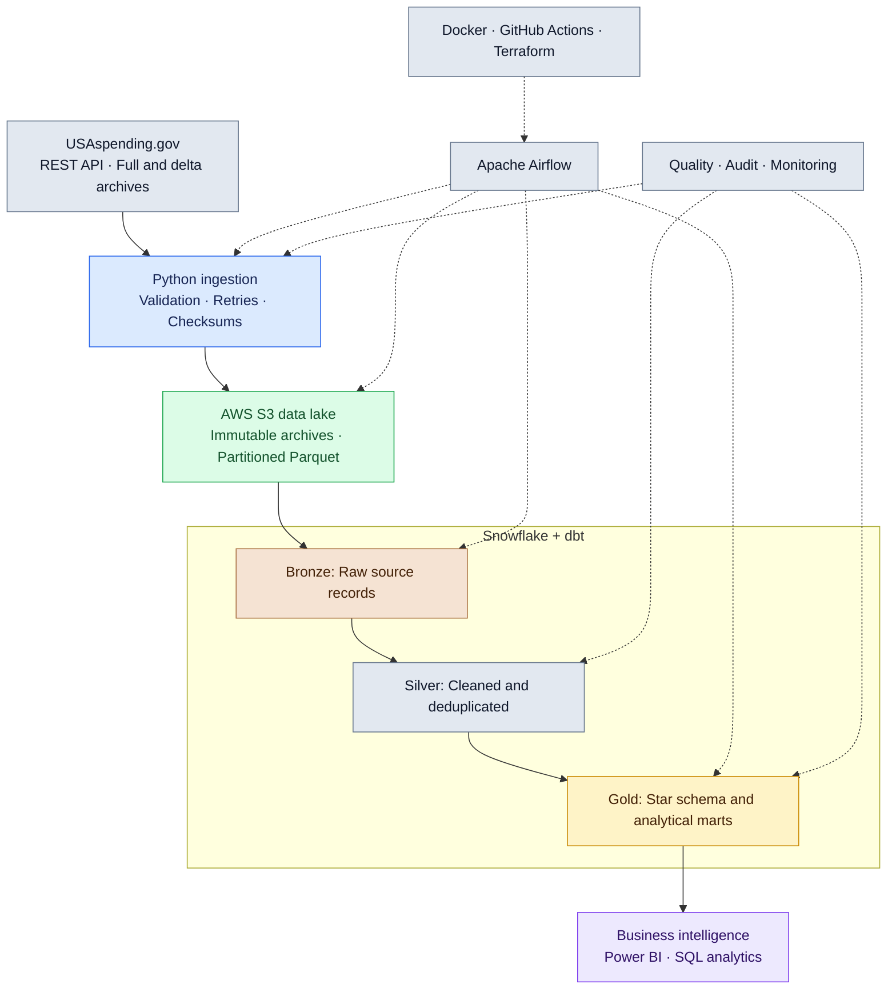
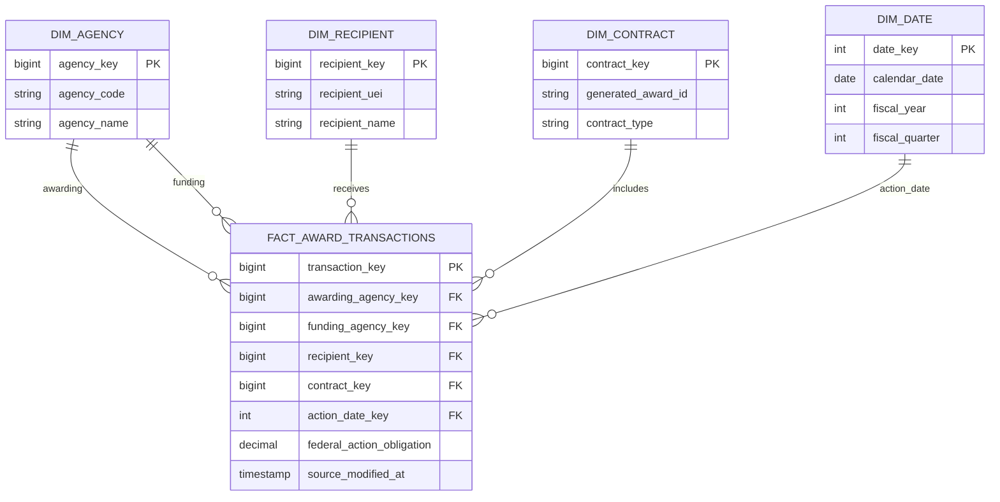
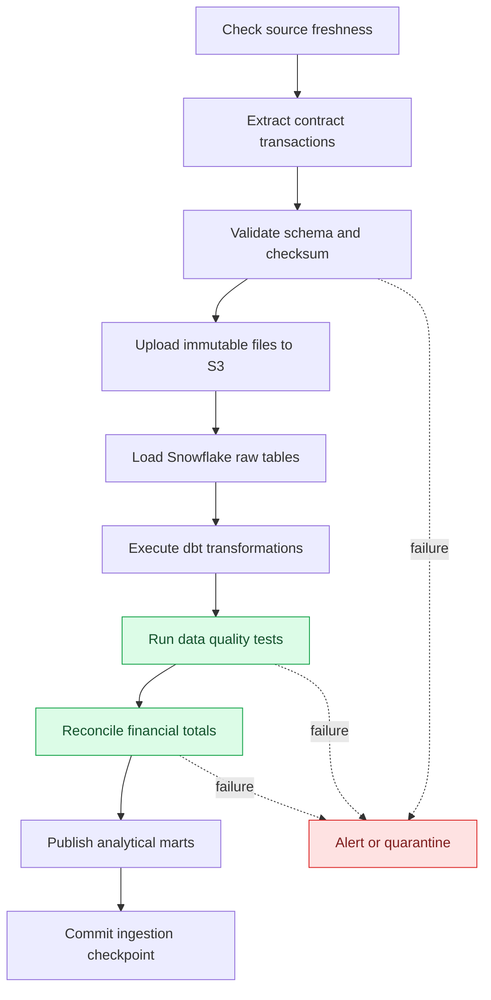

# Federal Spending Data Warehouse

> Transform raw federal procurement data into reliable, auditable, and actionable spending intelligence.

The Federal Spending Intelligence Platform (FSIP) is an enterprise-oriented data engineering project built on [USAspending.gov](https://www.usaspending.gov/).

**Status: Phase 1, Milestone 1 complete (reported).** Local API ingestion, validation, immutable archival, Parquet conversion, provenance and DuckDB reconciliation are implemented. AWS S3, Snowflake, dbt and Airflow remain planned; the cloud architecture diagrams describe the target system.

## Current implementation

```text
USAspending bulk_download API
        │  (async job: submit → poll → stream ZIP)
        ▼
 data/raw/<slug>/…             immutable source ZIP + extracted CSV
        │  (SHA-256 checksum, safe extraction)
        ▼
 validation + quarantine       schema contract, typing, dedup, negative-safe
        │
        ├──► data/parquet/<slug>.parquet     typed, decimal-exact valid rows
        ├──► data/quarantine/<slug>.csv      rejected rows + reasons
        └──► data/manifests/<slug>.json      provenance + reconciliation
```

- **Raw is immutable:** downloaded ZIPs are checksummed using SHA-256; normalization happens in derived Parquet.
- **Decimal-safe money:** financial fields use `decimal128(23,2)`; negative obligations are preserved.
- **No silent row rejection:** invalid rows are quarantined with machine-readable reasons.
- **Idempotent extraction:** deterministic output paths and completed-work skipping; `--force` reprocesses.
- **Schema drift is loud:** missing required columns abort ingestion; the observed 297-column layout is fingerprinted in the manifest.

### Milestone 1 validation

| Metric | Reported result |
|---|---|
| NASA October 2025 transactions | 196 |
| Valid / quarantined | 196 / 0 |
| Negative obligations preserved | 6 |
| Ingestion test coverage | 92% |
| Live API test | 1 passed |
| DuckDB reconciliation | Passed |
| Ruff lint and format | Passed |

These results describe the reported local execution, not remote CI or cloud deployment verification.

## Requirements and quickstart

Python **3.12+**. The public API requires no credentials; this milestone provisions no paid cloud infrastructure. Run from the cloned repository root.

```bash
python3.12 -m venv .venv
source .venv/bin/activate
pip install -e ".[dev]"
# Optional environment template
cp .env.example .env
fsdw extract --agency NASA --start 2025-10-01 --end 2025-10-31
python analytics/reconcile.py \
  --parquet data/parquet/nasa_contracts_action_date_20251001_20251031.parquet \
  --manifest data/manifests/nasa_contracts_action_date_20251001_20251031.json
```

One-shot wrapper: `scripts/run_nasa_october_2025.sh`.

### CLI reference

```bash
# Optional arguments are shown in brackets; omit brackets when executing.
fsdw extract --agency NASA --start 2025-10-01 --end 2025-10-31 \
  [--award-types contracts|idvs|contracts_and_idvs] \
  [--date-type action_date|last_modified_date] \
  [--agency-type awarding|funding] \
  [--data-dir ./data] \
  [--force]
fsdw agencies
```

Module alternative:

```bash
python -m ingestion.cli extract --agency NASA --start 2025-10-01 --end 2025-10-31
```

### Testing

```bash
pytest
pytest --cov=ingestion --cov-report=term-missing
ruff check .
ruff format --check .
pytest -m live  # opt-in, requires network and downloads real data
```

GitHub Actions (`.github/workflows/ci.yml`) is configured to run Ruff and offline tests on pushes and pull requests to main.

### Output layout

| Path | Contents |
|---|---|
| `data/raw/<slug>/*.zip` | Immutable checksummed ZIP |
| `data/raw/<slug>/extracted/*.csv` | Safely extracted CSV |
| `data/parquet/<slug>.parquet` | Typed valid transactions |
| `data/quarantine/<slug>.csv` | Rejected rows and `_quarantine_reasons` |
| `data/manifests/<slug>.json` | Provenance and reconciliation |

The slug is deterministic, e.g. `nasa_contracts_action_date_20251001_20251031`. The `data/` directory is git-ignored. Never commit credentials or generated datasets.

## Target system architecture



The platform separates source extraction, immutable storage, warehouse loading, transformation, validation and analytical publication. DuckDB supports local development before cloud deployment.

## Technology stack

| Technology     | Responsibility       | Skills demonstrated                 |
|----------------|----------------------|-------------------------------------|
| Python         | Data ingestion       | APIs, exception handling, ETL       |
| AWS S3         | Cloud data lake      | Object storage, partitioning        |
| Snowflake      | Data warehouse       | Cloud SQL, RBAC, query optimization |
| dbt Core       | Data transformation  | ELT, modeling, lineage              |
| Apache Airflow | Orchestration        | DAGs, scheduling, backfills         |
| SQL            | Analytics            | Joins, CTEs, window functions       |
| Apache Parquet | Storage format       | Columnar storage, compression       |
| Docker         | Local environment    | Containerization                    |
| Terraform      | Cloud infrastructure | Infrastructure as code              |
| GitHub Actions | CI/CD                | Automated testing and deployment    |
| Pytest         | Testing              | Unit and integration testing        |
| Power BI       | Visualization        | Business intelligence               |
| DuckDB         | Local development    | Low-cost SQL processing             |

Snowflake, dbt and Airflow are the primary specialization.

## Data sources and historical scope

[USAspending.gov](https://www.usaspending.gov/) provides federal procurement, award, recipient, agency and financial transaction data through public APIs and bulk archives.

The target historical scope is FY 2022–2026.

| Organization                    | Reason for inclusion               |
|---------------------------------|------------------------------------|
| Department of Defense           | Defense contracting                |
| Department of Homeland Security | Cybersecurity and infrastructure   |
| Department of Energy            | Scientific research and technology |
| NASA                            | Aerospace and research             |
| General Services Administration | Federal technology procurement     |

The October 2025 NASA API extraction is the initial development dataset. Processing the NASA FY 2026 Contracts Full File and expanding to other agencies are planned next steps. Fiscal years begin October 1 of the preceding calendar year.

### API endpoints

| Candidate endpoint                             | Intended purpose                |
|------------------------------------------------|---------------------------------|
| `/api/v2/bulk_download/awards/`                | Historical extraction           |
| `/api/v2/bulk_download/status/`                | Download job monitoring         |
| `/api/v2/awards/last_updated/`                 | Source freshness                |
| `/api/v2/references/toptier_agencies/`         | Agency reference data           |
| `/api/v2/references/naics/`                    | Industry classification         |
| `/api/v2/search/transaction_spending_summary/` | Financial reconciliation        |
| `/api/v2/transactions/`                        | Award transaction investigation |

Validate endpoint paths, methods, request schemas and date filters against the official API contract before implementation.

### Full and delta archives

Full files establish historical baselines. Delta files carry additions, corrections and deletions across their published coverage period. The archive's `correction_delete_ind` field identifies additions (blank), corrections (`C`) and deletions (`D`). Archive coverage and baseline dates must be aligned before applying deltas.

### Official resources

- [API documentation](https://api.usaspending.gov/docs/endpoints)

- [USAspending API source code](https://github.com/fedspendingtransparency/usaspending-api)

- [Federal Spending Guide](https://www.usaspending.gov/federal-spending-guide)

- [Award Data Archive](https://www.usaspending.gov/download_center/award_data_archive)

## Planned enterprise data warehouse model

The proposed dimensional star schema separates analytical facts from operational audit records. Agency is a role-playing dimension for awarding and funding agencies.



The diagram shows the core logical model. Physical types, source identifiers and historical dimension joins must be validated during implementation.

### Dimension tables

| Table           | Modeling technique                   |
|-----------------|--------------------------------------|
| `DIM_AGENCY`    | Slowly changing dimension Type 2     |
| `DIM_RECIPIENT` | Slowly changing dimension Type 2     |
| `DIM_CONTRACT`  | Slowly changing dimension Type 2     |
| `DIM_DATE`      | Static calendar and fiscal dimension |
| `DIM_NAICS`     | Industry classification              |
| `DIM_GEOGRAPHY` | Location dimension                   |

### Fact and operational tables

| Table                      | Grain                                                |
|----------------------------|------------------------------------------------------|
| `FACT_AWARD_TRANSACTIONS`  | One current record per source transaction            |
| `FACT_TRANSACTION_HISTORY` | One record per observed transaction version          |
| `FACT_PIPELINE_AUDIT`      | One record per pipeline execution                    |
| `FACT_DATA_QUALITY`        | One record per validation check and execution        |
| `FACT_RECONCILIATION`      | One record per source-to-target reconciliation scope |

### Analytical data marts

| Data mart                     | Business question                                  |
|-------------------------------|----------------------------------------------------|
| `MART_AGENCY_SPENDING`        | Which agencies obligate the most funding?          |
| `MART_CONTRACTOR_ANALYSIS`    | Which contractors receive the largest obligations? |
| `MART_FISCAL_TRENDS`          | How does procurement change across fiscal years?   |
| `MART_SPENDING_GEOGRAPHY`     | Where are federal contracts performed?             |
| `MART_INDUSTRY_SPENDING`      | Which industries receive federal funding?          |
| `MART_CONTRACT_MODIFICATIONS` | How frequently are contracts modified?             |
| `MART_DATA_QUALITY`           | Can analysts trust the underlying data?            |

## Production data engineering requirements

| Capability                          | Design requirement                                                                             |
|-------------------------------------|------------------------------------------------------------------------------------------------|
| Incremental ingestion and backfills | Last-modified-date watermarks, overlapping windows, durable checkpoints and replayable jobs    |
| Idempotency and deduplication       | Reprocessing identical input must not duplicate transactions or inflate totals                 |
| Historical preservation             | Preserve previous record versions, hashes, ingestion timestamps and source modification dates  |
| Financial reconciliation            | Compare transaction counts and net obligations across equivalent source and target scopes      |
| Data governance                     | Snowflake RBAC, least privilege, documented lineage and classification                         |
| Observability and failure recovery  | Monitor failures, rejected records, latency, freshness, schema drift and warehouse consumption |

**Financial correctness:** Obligations are not actual outlays. Preserve negative obligations and use decimal-safe financial types. Preserve original source files and audit corrections and deletions.

## Planned Apache Airflow pipeline



| DAG                            | Schedule  |
|--------------------------------|-----------|
| `federal_spending_incremental` | Daily     |
| `federal_spending_backfill`    | On demand |
| `reference_data_refresh`       | Weekly    |
| `historical_reconciliation`    | Weekly    |
| `warehouse_maintenance`        | Monthly   |

Checkpoints advance only after successful validation and publication. A daily task checks for source updates; it does not assume new monthly archive files are available every day.

## Current repository structure

```text
Federal-Spending-Data/
├── .github/workflows/ci.yml
├── ingestion/
│   ├── config.py
│   ├── client.py
│   ├── models.py
│   ├── validate.py
│   ├── storage.py
│   ├── manifest.py
│   ├── extract.py
│   └── cli.py
├── analytics/                 # DuckDB reconciliation
├── tests/                     # Unit and integration tests
├── airflow/dags/              # Stub
├── warehouse/                 # Stub
├── transformations/           # Stub
├── infrastructure/terraform/  # Stub
├── scripts/
├── docs/
│   ├── ARCHITECTURE.md
│   └── DATA_DICTIONARY.md
├── pyproject.toml
├── .env.example
├── .gitignore
├── LICENSE
└── README.md
```

## Implementation roadmap

- [x] Milestone 1: API ingestion, validation, manifests, Parquet and local reconciliation
- [ ] Milestone 2: Full archive ingestion, historical profiling and partitioning
- [ ] Milestone 3: AWS S3 data lake
- [ ] Milestone 4: Snowflake warehouse
- [ ] Milestone 5: dbt dimensional models and marts
- [ ] Milestone 6: Airflow orchestration and backfills
- [ ] Milestone 7: CDC, governance and production monitoring
- [ ] Milestone 8: Business intelligence, deployment and performance documentation

## Documentation

- [Architecture](docs/ARCHITECTURE.md) — components, data flow, design decisions and roadmap.
- [Data dictionary](docs/DATA_DICTIONARY.md) — stable contract columns, types and semantics.

## Target repository structure

```text
federal-spending-data-warehouse/
├── .github/
│   └── workflows/
│       ├── ci.yml
│       └── dbt-ci.yml
├── airflow/
│   └── dags/
│       ├── incremental.py
│       ├── backfill.py
│       ├── reference_data.py
│       ├── reconciliation.py
│       └── maintenance.py
├── ingestion/
│   ├── clients/
│   │   └── usaspending.py
│   ├── extractors/
│   ├── validators/
│   ├── storage/
│   │   ├── local.py
│   │   └── s3.py
│   ├── checkpoints.py
│   └── pipeline.py
├── warehouse/
│   ├── ddl/
│   ├── security/
│   └── snowflake/
├── transformations/
│   ├── dbt_project.yml
│   ├── models/
│   │   ├── staging/
│   │   ├── intermediate/
│   │   └── marts/
│   │       ├── dimensions/
│   │       └── facts/
│   ├── snapshots/
│   ├── macros/
│   ├── seeds/
│   └── tests/
├── infrastructure/
│   └── terraform/
├── analytics/
│   ├── sql/
│   ├── dashboards/
│   └── notebooks/
├── tests/
│   ├── unit/
│   ├── integration/
│   └── fixtures/
├── docs/
│   ├── architecture.md
│   ├── data_dictionary.md
│   ├── data_lineage.md
│   ├── runbook.md
│   └── adr/
├── scripts/
├── docker-compose.yml
├── Dockerfile
├── Makefile
├── pyproject.toml
├── .env.example
├── .gitignore
├── LICENSE
└── README.md
```

## Target acceptance criteria

- No duplicate current transaction keys.

- Exact financial reconciliation for equivalent complete scopes.

- Repeatable ingestion and recovery without duplicated transactions.

- Historical corrections and deletions are auditable.

- Published marts have documented lineage and quality tests.

- No hardcoded credentials.

## Data attribution

Source: USAspending.gov. This is an independent portfolio project and is not an official government service. No cloud production deployment is claimed at this stage.


## License

[MIT](LICENSE).
